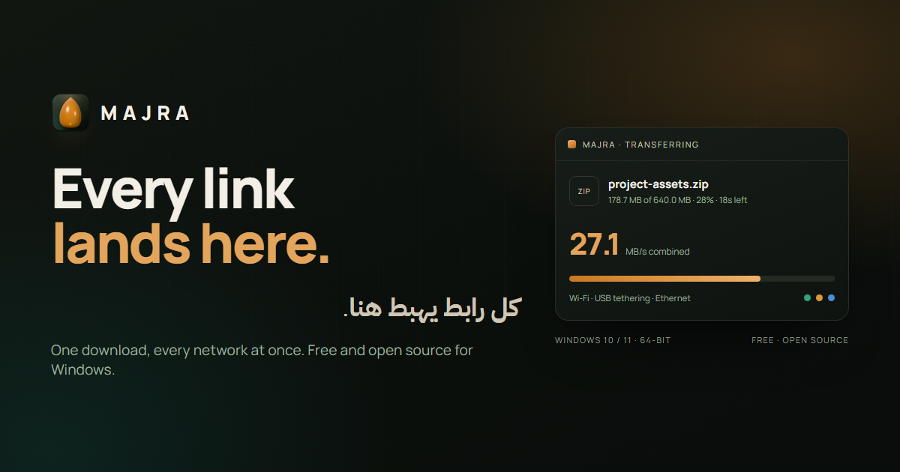

<p align="center">
  <a href="docs/banner.png"></a>
</p>

<h1 align="center">مجرى · Majra</h1>

<p align="center">
  <strong>كل رابط يهبط هنا.</strong><br />
  مدير تنزيلات مجاني ومفتوح المصدر لويندوز، يشغّل الواي فاي والإيثرنت وتوصيل USB وبيانات الهاتف
  على نفس الملف في الوقت نفسه.
</p>

<p align="center">
  <a href="https://github.com/bouadjadjatamer2-hub/Majra/releases/download/v1.2.3/Majra-1.2.3-Setup.exe"></a>
</p>

<p align="center">
  <a href="https://github.com/bouadjadjatamer2-hub/Majra/actions/workflows/ci.yml"></a>
  <a href="https://github.com/bouadjadjatamer2-hub/Majra"></a>
  <a href="https://github.com/bouadjadjatamer2-hub/Majra/releases/tag/v1.2.3"></a>
  <a href="LICENSE"></a>
  <a href="https://github.com/bouadjadjatamer2-hub/Majra/releases"></a>
  
</p>

<p align="center">
  <a href="#التثبيت">التثبيت</a> ·
  <a href="#المميزات">المميزات</a> ·
  <a href="#كيف-يعمل">كيف يعمل</a> ·
  <a href="#حدود-صريحة">الحدود</a> ·
  <a href="#البناء-من-المصدر">البناء من المصدر</a> ·
  <a href="#أسئلة-شائعة">أسئلة شائعة</a> ·
  <a href="README.md">English</a>
</p>

<a href="docs/screenshots/app-detail.png"></a>

## لماذا مجرى؟

معظم مديري التنزيلات يفتحون عدة اتصالات بخادم واحد عبر شبكة واحدة. مجرى يفتح الاتصالات عبر
**كل واجهة شبكة يعرضها ويندوز**، ويربط كل مسار بواجهة، ثم يعيد تركيب الكتل بالترتيب. هاتف على
توصيل USB، وشبكة واي فاي، وكابل إيثرنت — الثلاثة يمكنهم حمل نفس الملف في نفس اللحظة.

مجرى مبني للروابط الحقيقية: صفحات تتطلب تسجيل دخول، وخوادم تدعم byte-range، وأرشيفات ضخمة،
واتصالات تنقطع وتعود. بلا حساب، بلا إعلانات، بلا تتبّع، وبلا أدوات مرفقة.

## المميزات

| الميزة                           | ما تفعله                                                                                 |
| -------------------------------- | ---------------------------------------------------------------------------------------- |
| **كل الاتصالات معاً**            | الواي فاي والإيثرنت وتوصيل USB وبيانات الهاتف يمكنهم حمل نفس الملف في الوقت نفسه.        |
| **من 2 إلى 64 اتصالاً**          | اختر 2 أو 4 أو 8 أو 16 أو 32 اتصالاً متوازياً لكل شبكة. وضع Turbo يصل إلى 64.            |
| **تنزيل + فك ضغط**               | أرشيفات ZIP وRAR وTAR — بما فيها `.tar.gz` و`.tar.bz2` و`.tar.xz` — تُفكّ وهي تصل.       |
| **الروابط المباشرة تبقى مباشرة** | الصق رابط ملف وابدأ. بلا صفحة وسيطة وبلا حساب إجباري. التنزيلات المسجّلة تحتفظ بكوكيزها. |
| **من المتصفح إلى مجرى**          | إضافة Chromium ترسل التنزيل إلى مجرى مع كوكيز المتصفح، ثم تنسحب من الطريق.               |
| **تورنت ومغناطيس**               | افتح ملف `.torrent` أو رابط magnet كمصدر إضافي، لا كتطبيق ثانٍ.                          |
| **استئناف وجدولة**               | أوقف مؤقتاً، استأنف بعد إعادة التشغيل، وابدأ التنزيل في الوقت الذي تختاره.               |
| **يُغلق إلى شريط النظام**        | يواصل التنزيل بعد إغلاق النافذة. شغّله مع ويندوز يجده جاهزاً.                            |
| **فحص Defender**                 | يمكن فحص الملفات المنتهية بـ Windows Defender قبل فتحها.                                 |
| **محلي بالتصميم**                | الإعدادات والسجل وقائمة الانتظار على جهازك. لا شيء يُرسل إلى أي خادم.                    |

## التثبيت

### ويندوز 10 / 11 · 64-bit

1. نزّل **[Majra-1.2.3-Setup.exe](https://github.com/bouadjadjatamer2-hub/Majra/releases/download/v1.2.3/Majra-1.2.3-Setup.exe)** (127.8 ميغابايت).
2. شغّل المثبّت. الملف غير موقّع، لذا قد يُنبّهك Windows SmartScreen — اختر **More info → Run anyway**، أو ابنِ من المصدر.
3. افتح مجرى، الصق رابطاً، واضغط **Start**.

المثبّت مساعد: يمكنك اختيار المجلد والقرص، وينشئ اختصاراً على سطح المكتب.

### إضافة المتصفح

إضافة Chromium (Chrome وEdge وBrave وOpera) تلتقط التنزيلات من المتصفح وتُسلّمها لمجرى مع
الكوكيز الصحيحة.

1. نزّل **[Majra-Browser-Extension.zip](https://github.com/bouadjadjatamer2-hub/Majra/releases/download/v1.2.3/Majra-Browser-Extension.zip)**.
2. فُكّ ضغطها في مكان ثابت.
3. افتح `chrome://extensions`، فعّل **Developer mode**، اختر **Load unpacked**، ثم اختر المجلد.

### تحقّق من التنزيل

```powershell
Get-FileHash .\Majra-1.2.3-Setup.exe -Algorithm SHA256
```

بصمة SHA-256 للإصدار `v1.2.3`:

```text
E009724DD5601171F45874A69539C1464BC051B112472C11B87CCB40F5871B5E
```

## كيف يعمل

```text
        Wi-Fi ────────┐
 USB tethering ──────┼──► جدولة الكتل ──► ملف مرتّب على القرص
      Ethernet ──────┘
```

1. مجرى يسأل ويندوز عن واجهات الشبكة النشطة وعناوينها.
2. يُقسّم الملف إلى كتل، ويطلب كل كتلة عبر الواجهة التي عندها متسع.
3. الكتل الواصلة تُكتب بالترتيب؛ الكتل الناقصة تُطلب من مسار آخر.
4. عند وصول آخر كتلة، يمكن فكّ الأرشيف في مكانه.

الخادم الذي لا يدعم byte ranges لا يمكن تقسيمه، لذا يعود مجرى إلى مسار واحد لذلك الرابط. هذا
حدّ الخادم، لا خلل في التطبيق.

## حدود صريحة

- **مجرى لا يخلق عرض نطاق غير موجود.** اتصالان خلف نفس الراوتر غالباً يتشاركان نفس المنفذ، والسرعة المجمّعة لن تتضاعف.
- **Turbo يرفع عدد الاتصالات، لا قدرة الخادم.** بعض الخوادم تحدّ من الطلبات المتوازية الكثيفة أو تحجبها.
- **ليست كل الروابط قابلة للتقسيم.** الخوادم التي لا تدعم byte-range تعود إلى مسار واحد.
- **المثبّت غير موقّع.** لا توجد شهادة توقيع بعد، لذا قد يطلب SmartScreen تأكيداً.
- **هو مدير تنزيلات، لا VPN ولا بروكسي.** يستخدم الاتصالات التي يراها ويندوز أصلاً.

## البناء من المصدر

المتطلبات: **Node.js 22+** و**npm 10+**، وويندوز 10/11 لبناء نسخة ويندوز.

```powershell
git clone https://github.com/bouadjadjatamer2-hub/Majra.git
cd Majra
npm install
npm run dev
```

| الأمر                     | ما يفعله                                          |
| ------------------------- | ------------------------------------------------- |
| `npm run dev`             | تشغيل التطبيق في وضع التطوير                      |
| `npm run typecheck`       | فحص الأنواع للمعالج والواجهة والاختبارات والإضافة |
| `npm run test:e2e`        | تشغيل اختبارات Playwright الشاملة                 |
| `npm run build`           | بناء التطبيق                                      |
| `npm run build:win`       | بناء مثبّت ويندوز                                 |
| `npm run build:extension` | بناء إضافة المتصفح                                |

ملاحظات الحزم في [REBUILD.md](REBUILD.md)، ودليل الاستخدام بالعربية في
[docs/USAGE_AR.md](docs/USAGE_AR.md)، وما هو قادم في [docs/ROADMAP.md](docs/ROADMAP.md).

## أسئلة شائعة

<details>
<summary><b>هل يحتاج مجرى إلى حساب؟</b></summary>
لا. بلا تسجيل، بلا اشتراك، بلا إعلانات. التطبيق يعمل بلا إنترنت إلا في التنزيلات التي تبدأها.
</details>

<details>
<summary><b>هل يجمع تتبّعاً؟</b></summary>
لا. الإعدادات وقائمة الانتظار والسجل محفوظة محلياً. التطبيق لا يرسل بيانات استخدام إلى أي مكان.
</details>

<details>
<summary><b>هل ستتضاعف سرعتي مع شبكتين؟</b></summary>
فقط إذا كانتا مسارين حقيقيين منفصلين إلى الإنترنت. الواي فاي والإيثرنت خلف نفس الراوتر غالباً يتشاركان منفذاً واحداً، فالمكسب صغير أو صفر. هاتف على بيانات الهاتف مع اتصال منزلي هو مسار ثانٍ حقيقي.
</details>

<details>
<summary><b>لماذا يحذّرني SmartScreen؟</b></summary>
المثبّت غير موقّع رقمياً. ويندوز لا يستطيع التحقق من الناشر، فيطلب منك التأكيد. يمكنك التحقق من بصمة SHA-256 أعلاه، أو البناء من المصدر.
</details>

<details>
<summary><b>هل ينزّل من يوتيوب أو مواقع البث؟</b></summary>
لا. ينزّل الملفات والتورنت، لا بثّ الوسائط. لا توجد أداة التقاط وسائط مرفقة.
</details>

<details>
<summary><b>هل يعمل على macOS أو لينكس؟</b></summary>
المصدر يحتوي أهداف بناء لكليهما، لكن مثبّت ويندوز وحده منشور ومختبَر. اعتبر الأنظمة الأخرى بناءً ذاتياً.
</details>

<details>
<summary><b>أين تنزيلاتي وإعداداتي؟</b></summary>
التنزيلات تذهب إلى المجلد الذي تختاره (Downloads افتراضياً). الإعدادات وقائمة الانتظار والسجل في مجلد بيانات المستخدم على نفس الجهاز.
</details>

## المساهمة

تقارير الأخطاء وطلبات الدمج مرحّب بها. اقرأ [CONTRIBUTING.md](CONTRIBUTING.md) أولاً، وافتح
issue قبل بدء تغيير كبير. تقارير الأمان تتبع [SECURITY.md](SECURITY.md).

## الرخصة

مجرى منشور تحت [رخصة MIT](LICENSE). إشعارات الأطراف الثالثة في [NOTICE.md](NOTICE.md).

---

<p align="center">
  <sub>من نفس الورشة: <a href="https://github.com/bouadjadjatamer2-hub/DroidCrate"><b>DroidCrate</b></a> — ورشة خدمة أندرويد حذرة لويندوز.</sub>
</p>
