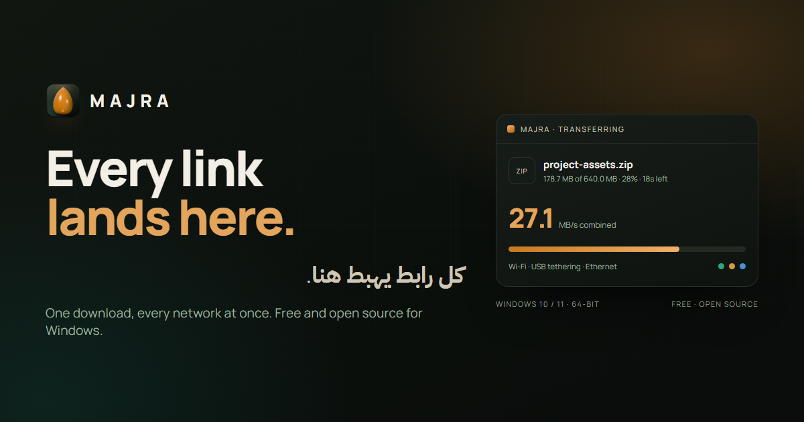

<p align="center">
  <a href="docs/banner.png"></a>
</p>

<p align="center">
  
</p>

<h1 align="center">Majra · مجرى</h1>

<p align="center">
  <strong>Every link lands here.</strong><br />
  A free, open-source download manager for Windows that puts Wi-Fi, Ethernet, USB tethering and
  mobile data to work on the same file.
</p>

<p align="center">
  <a href="https://github.com/bouadjadjatamer2-hub/Majra/releases/download/v2.0.3/Majra_2.0.3_x64-setup.exe"></a>
</p>

<p align="center">
  <a href="https://github.com/bouadjadjatamer2-hub/Majra/actions/workflows/ci.yml"></a>
  <a href="https://github.com/bouadjadjatamer2-hub/Majra"></a>
  <a href="https://bouadjadjatamer2-hub.github.io/Majra/"></a>
  <a href="https://github.com/bouadjadjatamer2-hub/Majra/releases/tag/v2.0.3"></a>
  <a href="LICENSE"></a>
  <a href="https://github.com/bouadjadjatamer2-hub/Majra/releases"></a>
  
</p>

<p align="center">
  <a href="https://bouadjadjatamer2-hub.github.io/Majra/">Website</a> ·
  <a href="#install">Install</a> ·
  <a href="#features">Features</a> ·
  <a href="#how-it-works">How it works</a> ·
  <a href="#honest-limits">Limits</a> ·
  <a href="#build-from-source">Build from source</a> ·
  <a href="#faq">FAQ</a> ·
  <a href="README.ar.md">العربية</a>
</p>

<a href="docs/screenshots/app-detail.png"></a>

## Why Majra

Most download managers open several connections to one server over one network. Majra opens
connections over **every network interface Windows exposes**, binds each stream to an interface, and
reassembles the blocks in order. A phone on USB tethering, a Wi-Fi link and an Ethernet cable can
carry the same archive at the same time.

It is built for real-world links: signed-in pages, byte-range servers, very large archives, and
connections that come and go. No account, no ads, no telemetry, no bundled toolbars.

## Features

| Feature                        | What it does                                                                                            |
| ------------------------------ | ------------------------------------------------------------------------------------------------------- |
| **Every connection, together** | Wi-Fi, Ethernet, USB tethering and mobile data can carry the same file at once.                         |
| **1 to 32 connections**        | Choose 1 to 32 parallel connections per download. There is no global speed cap.                         |
| **Download + extract**         | ZIP and TAR unpack while their blocks land; `.tar.gz` and `.tgz` unpack when the file is complete.      |
| **Direct links stay direct**   | Paste a file URL and go. No in-between page, no forced account. Signed-in downloads keep their cookies. |
| **Browser hand-off**           | The Chromium extension sends a download to Majra with the browser's cookies, then gets out of the way.  |
| **Proxy and routes**           | System, direct or a manual HTTP/SOCKS proxy. Every probe and transfer follows the same choice.          |
| **Resume and schedule**        | Pause, resume after a reboot, and run the queue inside a daily time window.                             |
| **Runs in the background**     | At sign-in it starts in the tray with no window, and opens only when a download needs you.              |
| **Defender scan**              | Finished files can be scanned with Windows Defender before you open them.                               |
| **Shut down when done**        | The PC can shut down after the last download, with a toast that lets you cancel.                        |
| **Local by design**            | Settings, history and queue live on your PC. Nothing is sent to a server.                               |

## Install

### Windows 10 / 11 · 64-bit

1. Download **[Majra_2.0.3_x64-setup.exe](https://github.com/bouadjadjatamer2-hub/Majra/releases/download/v2.0.3/Majra_2.0.3_x64-setup.exe)**.
2. Run the installer. It is unsigned, so Windows SmartScreen may warn you — choose **More info → Run anyway**, or build from source.
3. Launch Majra, paste a link, and press **Start**.

Version 2.0.3 is the Rust/Tauri rewrite. It keeps the same app identity as 1.2.3, so installing it replaces the old Electron build. Its settings and queue live in `%APPDATA%\app.majra.desktop`, separate from the old app's data.

### What changed in 2.0.3

- **Runs in the background.** The login entry starts Majra in the tray with no window: the queue and the browser bridge are ready, but the desktop stays clear until you need them.
- **Opens when you ask for a download.** A link handed over by the browser extension, the tray's **New download** item, or a second launch brings the window forward. Otherwise it stays hidden.
- **No startup flash.** The window is created hidden and only shown when it should be, instead of appearing and disappearing at sign-in.
- **Smaller fixes.** The startup and tray labels now describe what actually happens, and a background start no longer steals focus when another copy is already running.

### Browser extension

The Chromium extension (Chrome, Edge, Brave, Opera) captures downloads from the browser and hands
them to Majra with the right cookies.

1. Download **[Majra-Browser-Extension.zip](https://github.com/bouadjadjatamer2-hub/Majra/releases/download/v2.0.3/Majra-Browser-Extension.zip)**.
2. Unzip it somewhere permanent.
3. Open `chrome://extensions`, enable **Developer mode**, choose **Load unpacked**, and select the folder.

### Verify the download

```powershell
Get-FileHash .\Majra_2.0.3_x64-setup.exe -Algorithm SHA256
```

The SHA-256 for `v2.0.3` is:

```text
BBD08A35BCA7E11D57F894FFB1ECD3CC45AFC6EC1B5AEB3B657E3B420289465F
```

## How it works

```text
        Wi-Fi ────────┐
 USB tethering ──────┼──► block scheduler ──► ordered file on disk
      Ethernet ──────┘
```

1. Majra asks Windows for the active network interfaces and their addresses.
2. The file is split into blocks, and each block is requested over the interface with room to spare.
3. Arrived blocks are written in order; missing blocks are re-requested from another stream.
4. When the last block lands, the archive can be extracted in place.

A server that does not support byte ranges cannot be split, so Majra falls back to a single stream
for that link. That is a server limit, not a bug.

## Honest limits

- **Majra cannot create bandwidth that is not there.** Two connections behind the same router often share one uplink; the combined speed will not double.
- **More connections do not raise the server's capacity.** Some servers rate-limit or block aggressive parallel requests.
- **Not every link can be split.** Servers without byte-range support fall back to one stream.
- **The installer is unsigned.** There is no code-signing certificate yet, so SmartScreen may ask you to confirm.
- **It is a download manager, not a VPN.** The proxy setting only routes Majra's own traffic over a proxy you already have.
- **Some features are not in 2.0.3 yet.** Torrents and magnets, RAR extraction, media sniffing, site grabbing, importing from another manager, and auto-update are still missing. The old 1.2.3 app advertised some of these; this README and the website now describe what the release actually does.

## Build from source

Version 2.0.3 lives in [`next/`](next/): a Rust core, a Tauri shell and a Svelte UI. The
1.2.3 Electron sources are still at the repository root for reference.

Requirements: **Rust 1.82+**, **Node.js 22+**, **npm 10+**, the Tauri prerequisites for
Windows (WebView2 and the MSVC build tools), and Windows 10/11.

```powershell
git clone https://github.com/bouadjadjatamer2-hub/Majra.git
cd Majra/next
npm install
npm run tauri dev
```

| Command                | What it does                                      |
| ---------------------- | ------------------------------------------------- |
| `npm run tauri dev`    | Start the Rust + Svelte app in development mode   |
| `npm run check`        | Type-check the Svelte UI                          |
| `cargo test`           | Run the core, bridge, download and settings tests |
| `npm run tauri build`  | Build the Windows executable and NSIS installer   |

The browser extension source is in [`extension/`](extension). The site in [`docs/`](docs)
is served by GitHub Pages from `main`.

## FAQ

<details>
<summary><b>Does Majra need an account?</b></summary>
No. There is no sign-up, no subscription and no ads. The app works offline except for the downloads you start.
</details>

<details>
<summary><b>Does it collect telemetry?</b></summary>
No. Settings, queue and history are stored locally. The app does not send usage data anywhere.
</details>

<details>
<summary><b>Will two networks double my speed?</b></summary>
Only if they are genuinely separate paths to the internet. Wi-Fi and Ethernet behind the same router usually share one uplink, so the gain is small or zero. A phone on mobile data plus a home connection is a real second path.
</details>

<details>
<summary><b>Why does SmartScreen warn me?</b></summary>
The installer is not code-signed. Windows cannot verify the publisher, so it asks you to confirm. You can check the SHA-256 above, or build from source.
</details>

<details>
<summary><b>Can Majra download from YouTube or other streaming sites?</b></summary>
No. It downloads files, not media streams. There is no bundled media sniffer and no torrent client in 2.0.3.
</details>

<details>
<summary><b>Does it work on macOS or Linux?</b></summary>
The source contains build targets for both, but only the Windows installer is published and tested. Treat other platforms as build-it-yourself.
</details>

<details>
<summary><b>Where are my downloads and settings?</b></summary>
Downloads go to the folder you choose (Downloads by default). Settings, queue and history live in the app's user-data folder on the same PC.
</details>

## Contributing

Bug reports and pull requests are welcome. Read [CONTRIBUTING.md](CONTRIBUTING.md) first, and open an
issue before starting a large change. Security reports should follow [SECURITY.md](SECURITY.md).

## License

Majra is released under the [MIT License](LICENSE). Third-party notices are in [NOTICE.md](NOTICE.md).

---

<p align="center">
  <sub>Also from the same workbench: <a href="https://github.com/bouadjadjatamer2-hub/DroidCrate"><b>DroidCrate</b></a> — a careful Android service bench for Windows.</sub>
</p>
